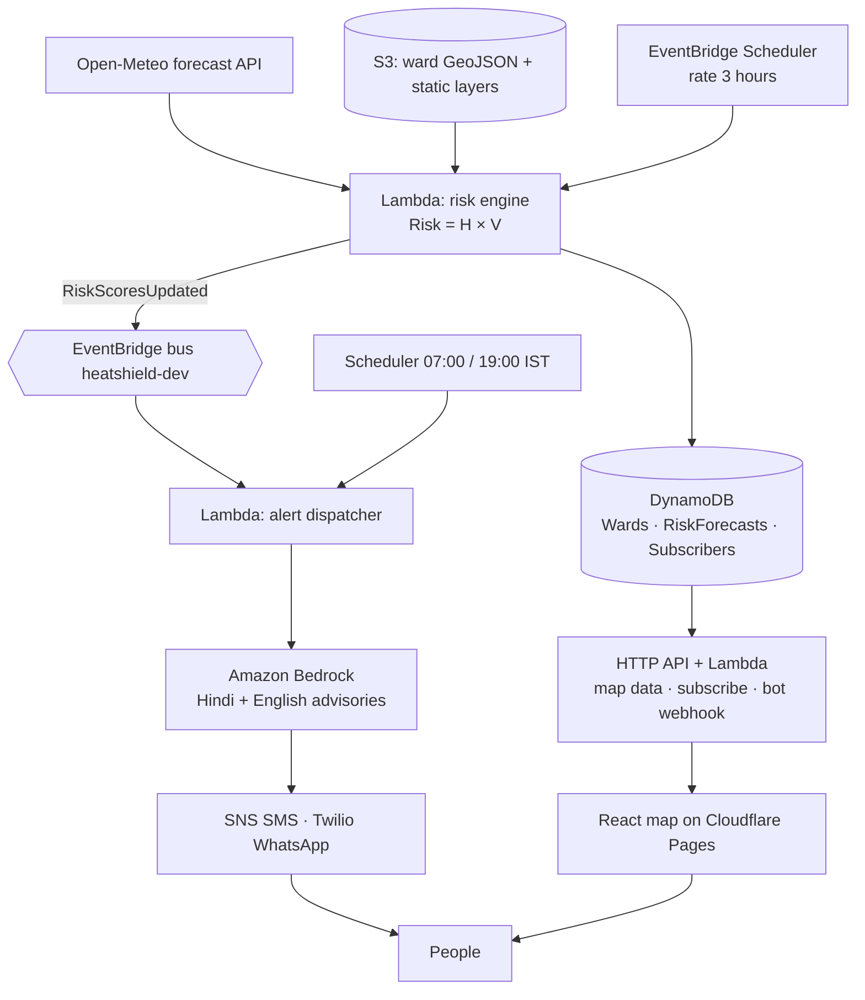

# HeatShield

Ward-level heat risk for Indian cities, with plain-language alerts on WhatsApp and SMS in Hindi and English. Built for the WeMakeDevs x AWS hackathon, Track 02: Heat and Water. The pilot city is Delhi.

HeatShield combines the weather forecast with how exposed each ward is (surface heat, green cover, population density) and scores every ward as `Risk = Hazard × Vulnerability` every 3 hours. Residents subscribe by ward and get a short alert the evening before and the morning of a High or Extreme day. Ward officers use the map to see where water points and cooling centres matter most.

**Why not just Google Weather?** A temperature or "feels like" number misses what actually hurts people in Indian cities: humid heat at work, nights that don't cool down, and rooms under tin roofs. So HeatShield also estimates WBGT, the work-safety standard, and gives outdoor workers an hourly work-rest plan. It flags hot nights and raises the alert level for thin-roof homes. Each alert names the nearest verified cooling centre or water point. On the worst days it checks on elderly people (reply OK or SOS) and tells a caregiver if they need help. Each ward office gets a daily checklist. The evidence, competitor teardown and buyer analysis are in [docs/research/](docs/research/README.md).

> **Status: code complete, needs accounts and data.** Risk scores use live Open-Meteo forecasts and IMD-based hazard bands; alerts, the Claude-written advisories and the WhatsApp bot are built and tested. Still to do by hand: real ward boundaries and rasters (Phase 1, [data/README.md](data/README.md)), the Twilio sandbox, Bedrock model access, and the Cloudflare deploy. The ward layer is a placeholder hex grid until then. See [docs/architecture.md](docs/architecture.md) and [ROADMAP.md](ROADMAP.md).

## How it works



Details: [docs/architecture.md](docs/architecture.md) (risk model, alert rules, replay mode, data model, API).

## Repository layout

```
backend/     AWS SAM app: template.yaml, 4 Python Lambdas, shared layer, tests
  functions/   api · risk_engine · alert_dispatcher · whatsapp_webhook
  layers/common/heatshield/   config, models, heat/hazard, risk, weather, advisory, messaging, DynamoDB access
data/        ward layer fixture, seeding, Phase 1 ward-layer builder, replay fetcher
frontend/    React + Vite + MapLibre web map, deployed to Cloudflare Pages
docs/        architecture, data model, API contract
Makefile     every command you need
```

## Prerequisites

- AWS CLI v2 with the `saurav-cli` profile (`aws sts get-caller-identity --profile saurav-cli`)
- AWS SAM CLI (`uv tool install aws-sam-cli`), [uv](https://docs.astral.sh/uv/), Python 3.12
- Node 22+ (Wrangler is a dev dependency, so there's nothing to install globally)
- Cloudflare account: run `npx wrangler login` once inside `frontend/`
- For alerts: Bedrock model access for Claude in `us-east-1` (console → Bedrock → Model access), a Twilio account with the WhatsApp sandbox (`make twilio-params`), and an SNS SMS sandbox number

## Commands

```bash
make install          # uv sync + npm install
make test             # backend unit tests (pytest + moto, no network)
make test-data        # data pipeline tests (rasterio, synthetic rasters)
make lint             # ruff, sam validate --lint, tsc
make deploy-backend   # sam build && sam deploy  -> stack heatshield-dev (us-east-1)
make seed             # load the ward layer into S3 + DynamoDB (WARDS_FILE=... for real wards)
make invoke-risk      # score all wards now instead of waiting for the schedule
make replay-fetch DATE=2024-05-28   # store a past heatwave for off-season demos
make replay DATE=2024-05-28         # score from it (map shows "Replay of ..."); make live to go back
make twilio-params    # store Twilio credentials in SSM (prompts)
make sms-setup        # SNS SMS: transactional, spend cap
make invoke-alerts    # run the alert dispatcher now
make dev              # local map at http://localhost:5173 against the deployed API
make snapshot         # save scored wards as static JSON so the map runs without an API (REPLAY=2024-05-28 for a heatwave)
make deploy-frontend  # build + publish to Cloudflare Pages (project "heatshield")
make deploy           # both
make logs FN=risk-engine
make destroy          # delete the stack (asks first; subscribers table is kept)
```

## Build plan

The full task list for every phase, with checklists, is in [ROADMAP.md](ROADMAP.md).

1. **Data foundation**: real MCD ward boundaries, Landsat LST, Sentinel-2 NDVI, WorldPop density per ward ([data/README.md](data/README.md))
2. **Risk engine and map**: Open-Meteo pulls, the real `H × V`, IMD-tuned thresholds, replay mode for an off-season demo
3. **AI and alerts**: Bedrock advisories per group and language, Twilio WhatsApp + SNS SMS, quiet hours and the 2-a-day cap, Ask HeatShield bot
4. **Polish**: demo video, cost notes, architecture diagram
