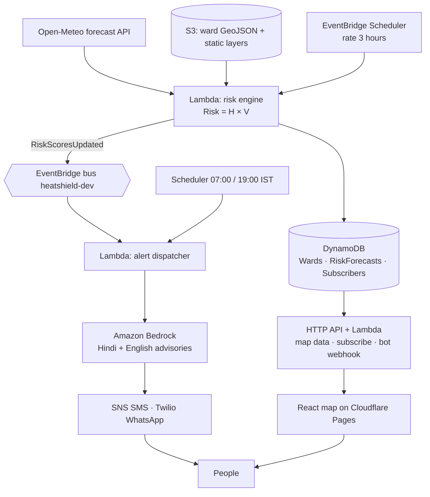

# HeatShield architecture

Every 3 hours, forecasts become ward risk scores, alerts and a live map. Everything runs serverless on AWS (`us-east-1`), except the static web map, which is served from Cloudflare Pages.

## What is real now

| Piece | State |
|---|---|
| DynamoDB tables, S3 bucket, event bus, schedules, HTTP API, IAM | Deployed |
| `GET /wards`, `GET /wards/{id}/forecast`, `POST /subscribe`, `POST /unsubscribe` | Working against real tables |
| Risk engine | Live Open-Meteo hourly forecasts → felt temperature → H (IMD bands) → `H × V`; replay mode for a past heatwave |
| Alert dispatcher | Sends WhatsApp (Twilio) and SMS (SNS) with the daily cap and de-duplication; advisories from Claude on Bedrock with template fallback. WhatsApp sends are logged dry runs until the Twilio parameters exist in SSM |
| WhatsApp webhook | Verifies `X-Twilio-Signature`; STOP / START; Ask HeatShield answers from the ward's forecast. Rejects every request (403) until Twilio is configured |
| Ward layer | **Synthetic hex grid** over Delhi (`data/fixtures/delhi_wards.geojson`) until real boundaries and rasters are run through `data/scripts/build_ward_layer.py` |

## Data model

| Table | PK | SK | Fields |
|---|---|---|---|
| `heatshield-dev-wards` | `wardId` | | name, city, geometryS3Key, centroid `[lon, lat]`, fixture, lstOffset, ndvi, popDensity, vulnerabilityScore, **daily** (per-day peak summary written by the risk engine), replayOf (set while replaying) |
| `heatshield-dev-risk-forecasts` | `wardId` | `forecastTime` (UTC ISO hour) | heatIndex, hazard, risk, level, generatedAt, expiresAt (TTL, 5 days) |
| `heatshield-dev-subscribers` | `phone` (E.164) | | wardId, group, language, channel, optedIn, createdAt, lastAlertAt, alertDate, alertsToday, lastAlertKey. GSI `byWard` on wardId. Retained on stack delete. |

All tables use KMS encryption at rest. "Days" are Delhi calendar days (IST); timestamps are stored in UTC.

`daily` is denormalised onto the ward row so the map loads with one table scan instead of one query per ward.

## API

Base URL: stack output `ApiUrl`. CORS allows `https://heatshield.pages.dev` and `http://localhost:5173` (template parameter `AllowedOrigins`). Throttled to 20 req/s, burst 50.

| Method and path | Returns |
|---|---|
| `GET /wards` | GeoJSON FeatureCollection; each feature's properties carry ward attributes, `fixture`, and `daily[0..3]` = `{date, risk, level, heatIndex, peakAt}`. Top-level `replayOf` is the replayed date or `null` |
| `GET /wards/{wardId}/forecast` | `{ward, hourly[96]}`, from midnight IST today to the end of day +3 |
| `POST /subscribe` | `{phone: "+91…", wardId, group: worker\|parent\|elderly, language: hi\|en, channel: whatsapp\|sms}` → 201 |
| `POST /unsubscribe` | `{phone}` → 200 (same response whether or not the number exists) |
| `POST /webhook/whatsapp` | Twilio form post (signed) → TwiML; 403 if the signature is missing or wrong |

## Risk model

`Risk = H × V`, both in [0, 1].

**Hazard H** (`backend/layers/common/heatshield/heat.py`), per ward and hour:

1. Open-Meteo hourly 2 m temperature and relative humidity, pulled on a 0.1° grid (one batched request for the city) and interpolated onto IST half-hours.
2. Felt temperature = max(air temperature, NWS heat index) + 0.35 × the ward's `lstOffset`. Taking the max keeps Delhi's dry pre-monsoon heat from being under-counted; 0.35 scales a surface-temperature anomaly down to what reaches the air.
3. H is piecewise linear on IMD's heat-index bands: 27 °C → 0, 35 °C (yellow) → 0.25, 45 °C (orange) → 0.55, 55 °C (red) → 0.85, 60 °C → 1.
4. IMD heatwave floors on air temperature alone: ≥ 45 °C → H ≥ 0.75, ≥ 47 °C (severe) → H ≥ 0.9.

**Vulnerability V** (`data/scripts/vulnerability.py`), static per ward:

| Input | Normalised | Weight (with census groups) | Weight (without) |
|---|---|---|---|
| Population density | people/km² ÷ 45,000, capped at 1 | 0.50 | 0.55 |
| Low green cover | 1 − NDVI ÷ 0.6, clamped | 0.35 | 0.45 |
| Children under 6 + people over 60 | share ÷ 0.25, capped at 1 | 0.15 | n/a |

Surface heat is not in V because it already raises H.

**Levels** (`risk.py`): Low < 0.18 ≤ Moderate < 0.30 ≤ High < 0.45 ≤ Extreme. For a ward of median V (0.43): an ordinary 40 °C afternoon is Moderate, an IMD heatwave hour is High, and a severe heatwave hour like Delhi on 28 May 2024 is High, or Extreme from V ≈ 0.5 up. The backtest cases are in `backend/tests/test_risk.py`.

**When the weather pull fails**, the engine writes nothing and emits no `RiskScoresUpdated`; the last good scores stay up and the 07:00 / 19:00 dispatches still run on them. Every live pull is kept at `s3://…/raw/forecasts/{date}/{hour}.json`.

## Replay mode

Off-season, nothing on the map is red. `make replay-fetch DATE=2024-05-28` downloads that heatwave's recorded hourly weather from the Open-Meteo archive and stores it at `replay/delhi/2024-05-28.json`. `make replay DATE=2024-05-28` scores from it, with 28 May moved onto today, and the map shows a "Replay of 28 May 2024" banner. The next 3-hourly run goes back to live forecasts; to hold the replay for a demo, add `ReplayDate=2024-05-28` to `parameter_overrides` in `backend/samconfig.toml`, run `make deploy-backend`, and remove it afterwards.

## Alerts

| Rule | How |
|---|---|
| Who | Subscribers of wards whose target day is High or Extreme. Evening runs (≥ 17:00 IST) warn about tomorrow, earlier runs about today |
| When | 07:00 and 19:00 IST schedules, plus after every risk-engine run. Never 22:00–06:00 IST |
| At most 2 a day | `repo.claim_alert`: a conditional update on the subscriber row (`alertDate`, `alertsToday`) before sending, so overlapping runs can't double-send |
| No repeats | `lastAlertKey` = `<target date>:<level>:<morn/eve>`. A 3-hourly refresh with the same level is skipped; an escalation to Extreme still goes out (within the cap) |
| Content | How bad (level, feels-like °C), when (the hours at High or above), what to do, and how to stop: every message ends with "Reply STOP" |
| WhatsApp | Twilio REST API; credentials from SSM SecureStrings `/heatshield/dev/twilio/{account-sid,auth-token,whatsapp-from}` (`make twilio-params`) |
| SMS | SNS transactional SMS. Short template: one GSM segment in English, at most two Unicode segments in Hindi. `make sms-setup` sets the spend cap. Indian numbers need DLT registration outside the SNS sandbox |

**Advisories.** The "what to do" sentence comes from Claude on Amazon Bedrock (Messages API on `bedrock-mantle`, model `anthropic.claude-opus-5-5` at low effort, `AdvisoryModelId` parameter), prompted with a fixed safety guide distilled from NDMA/IMD heat-wave advice and nothing else. Output is checked (length, no links, Devanagari for Hindi) and replaced by the human-reviewed template for that group, level and language if it fails, if Bedrock refuses, or on any error. Advice is cached per (level, risky hours, group, language) for the run, so a dispatch makes a handful of Bedrock calls at most. Set `AdvisoryMode=template` to skip Bedrock entirely.

**Ask HeatShield.** Inbound WhatsApp messages hit `POST /webhook/whatsapp`. Unsigned or wrongly signed requests get 403 and change nothing. STOP (or बंद) opts out, START opts back in, unknown numbers get the subscribe link, and anything else is a question: Claude answers from that ward's next 48 hours of forecast and the same safety guide, in the subscriber's language, with no medical advice beyond "call 108 / 112". If Bedrock is unavailable the bot replies with today's level and standard advice.

Before the first send: enable the Claude model in the Bedrock console (Model access), and connect the Twilio WhatsApp sandbox's "When a message comes in" URL to `<ApiUrl>/webhook/whatsapp`.

## Cost notes

With 289 wards × 96 hours, each risk-engine run writes ~28k forecast rows (on-demand, ≈ $0.035 a run, ≈ $0.28 a day at 8 runs). Open-Meteo is free for non-commercial use. Bedrock calls are capped by the advisory cache (≤ 12 distinct advisories per dispatch: 2 levels × 3 groups × 2 languages, times distinct risky-hour windows) plus one per bot question. Lambda, the API, EventBridge and S3 stay within the free tier at hackathon traffic.
