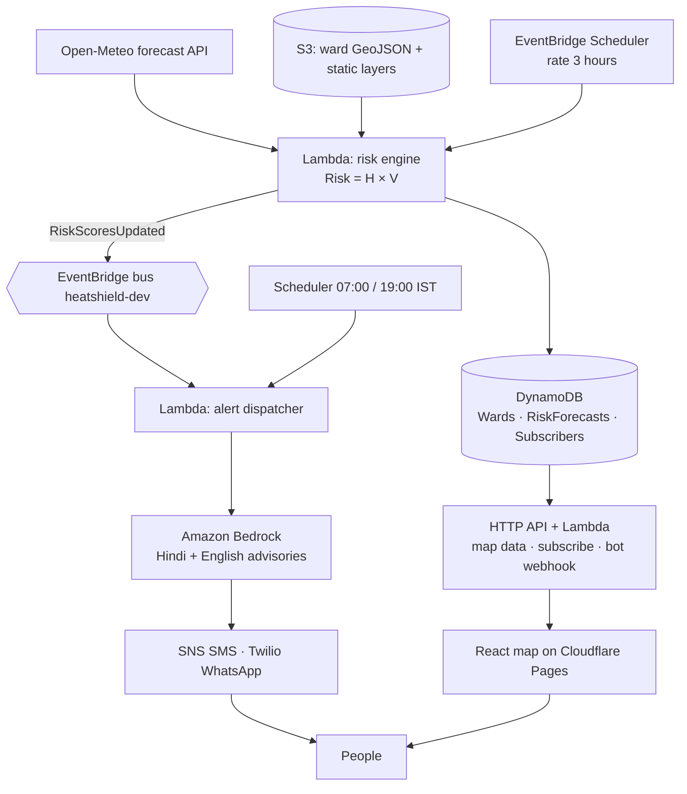

# HeatShield architecture

Every 3 hours, forecasts become ward risk scores, alerts and a live map. Everything runs serverless on AWS (`us-east-1`), except the static web map, which is served from Cloudflare Pages.

## What is real in the skeleton

| Piece | State |
|---|---|
| DynamoDB tables, S3 bucket, event bus, schedules, HTTP API, IAM | Deployed |
| `GET /wards`, `GET /wards/{id}/forecast`, `POST /subscribe`, `POST /unsubscribe` | Working against real tables |
| Risk engine | Writes real rows, but hazard is a **placeholder curve** (`placeholder_hazard`) |
| Alert dispatcher | Selects High/Extreme wards + subscribers and **logs** what it would send |
| WhatsApp webhook | Returns a fixed TwiML reply; does not change state |
| Ward layer | **Synthetic hex grid** over Delhi (`data/fixtures/delhi_wards.geojson`) |

## Data model

| Table | PK | SK | Fields |
|---|---|---|---|
| `heatshield-dev-wards` | `wardId` | | name, city, geometryS3Key, lstOffset, ndvi, popDensity, vulnerabilityScore, **daily** (per-day peak summary written by the risk engine) |
| `heatshield-dev-risk-forecasts` | `wardId` | `forecastTime` (UTC ISO hour) | heatIndex, hazard, risk, level, generatedAt, expiresAt (TTL, 5 days) |
| `heatshield-dev-subscribers` | `phone` (E.164) | | wardId, group, language, channel, optedIn, lastAlertAt, createdAt. GSI `byWard` on wardId. Retained on stack delete. |

All tables use KMS encryption at rest. "Days" are Delhi calendar days (IST); timestamps are stored in UTC.

`daily` is denormalised onto the ward row so the map loads with one table scan instead of one query per ward.

## API

Base URL: stack output `ApiUrl`. CORS allows `https://heatshield.pages.dev` and `http://localhost:5173` (template parameter `AllowedOrigins`). Throttled to 20 req/s, burst 50.

| Method and path | Returns |
|---|---|
| `GET /wards` | GeoJSON FeatureCollection; each feature's properties carry ward attributes and `daily[0..3]` = `{date, risk, level, heatIndex, peakAt}` |
| `GET /wards/{wardId}/forecast` | `{ward, hourly[96]}`, from midnight IST today to the end of day +3 |
| `POST /subscribe` | `{phone: "+91…", wardId, group: worker\|parent\|elderly, language: hi\|en, channel: whatsapp\|sms}` → 201 |
| `POST /unsubscribe` | `{phone}` → 200 (same response whether or not the number exists) |
| `POST /webhook/whatsapp` | Twilio form post → TwiML |

## Risk model

`Risk = H × V`, both in [0, 1] (`backend/layers/common/heatshield/risk.py`). Level thresholds are placeholders (0.30 / 0.50 / 0.70) until Phase 2 tunes them against IMD heat-index bands.

## Cost notes

With 289 wards × 96 hours, each risk-engine run writes ~28k forecast rows (on-demand, ≈ $0.035 a run, ≈ $0.28 a day at 8 runs). Lambda, the API, EventBridge and S3 stay within the free tier at hackathon traffic.
